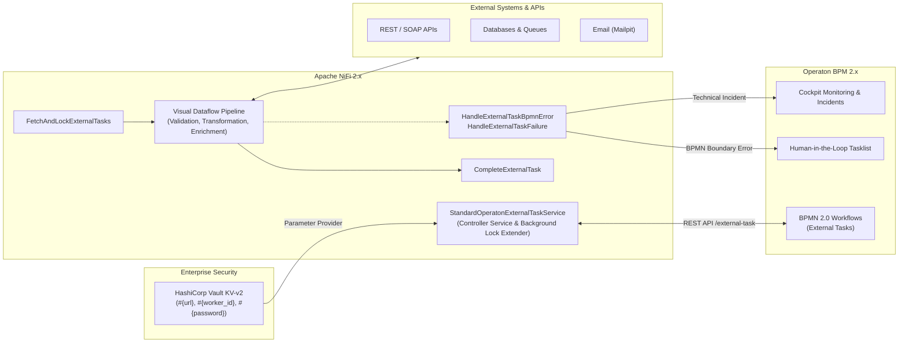
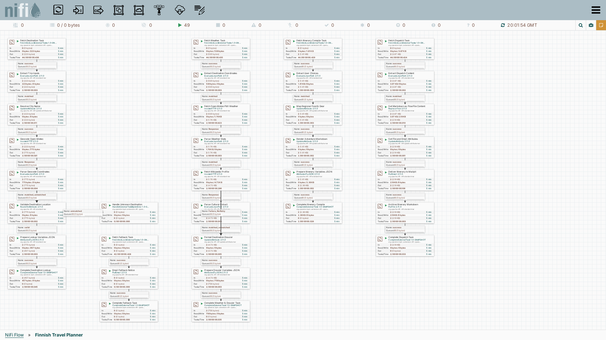
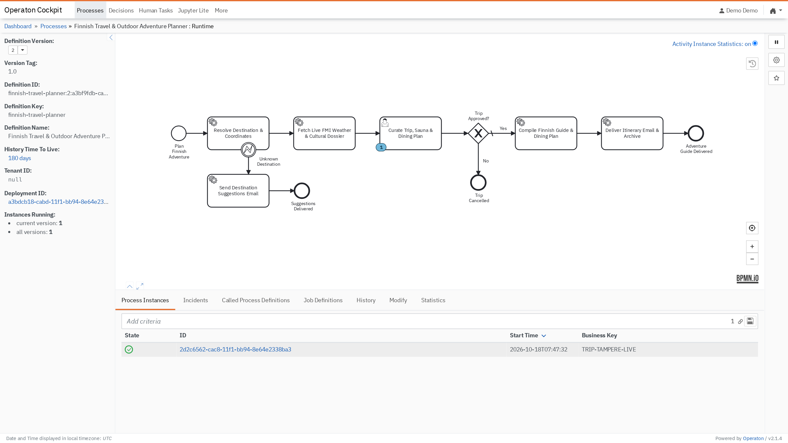

# Operaton NiFi External Task Worker

[](https://codespaces.new/datakurre/operaton-nifi-service)

**Operaton NiFi External Task Worker** bridges [Operaton BPM](https://operaton.org) (an open-source, lightweight BPMN 2.0 workflow engine) with [Apache NiFi 2.x](https://nifi.apache.org) (an enterprise-scale, visual dataflow and stream processing platform).

By implementing the **External Task Pattern**, it completely decouples business process state orchestration from heavy integration, data transformation, and external service communication.

---

## 🚀 Key Highlights & Main Features

- 🔌 **Zero-Code External Tasks**: Connect Operaton BPMN service tasks directly to NiFi dataflows via pre-configured [Operaton Element Templates](https://github.com/datakurre/operaton-nifi-service/tree/main/.operaton/element-templates) in the modeler.
- ⏱️ **Automatic Background Lock Extension**: Built-in background lease renewal ensures tasks never time out during long-running ETL jobs, batch database updates, or slow third-party API calls—without modifying flow logic.
- 🛡️ **BPMN Business Errors vs. Technical Failures**: Distinguish domain errors routed to BPMN boundary events (`HandleExternalTaskBpmnError`) from operational incidents with automatic retries and backoff (`HandleExternalTaskFailure`).
- 🔄 **Simple JSON & Type Preservation**: Exchange intuitive, plain JSON payloads in NiFi FlowFiles while transparently preserving complex Java/BPMN data types (`Long`, `Date`, `Xml`, `Object`) across the round trip.
- 🔐 **Enterprise Secrets with HashiCorp Vault**: Native NiFi Parameter Contexts backed by HashiCorp Vault KV-v2 (`HashiCorpVaultParameterProvider`), alongside OAuth2 Client Credentials, Bearer token, and Basic Auth.
- 💻 **Complete Local Stack in Minutes**: Fully reproducible development environment via [devenv](https://devenv.sh) packaging Operaton 2.x, NiFi 2.11.0, HashiCorp Vault, and Mailpit.

---

## 🏛️ Architectural Overview

Operaton maintains process instances, execution tokens, and business transaction state. When a process token reaches an external task, NiFi long-polls the Operaton REST API, locks the task, executes the processing dataflow, and reports completion or errors back to the engine.



---

## 📸 Visual Showcase

### Visual Dataflow Pipelines in Apache NiFi 2.11.0
Build modular, self-documenting dataflow pipelines that subscribe to external task topics, enrich data from open APIs, and coordinate delivery:



### Real-Time Process Orchestration in Operaton Cockpit
Monitor live process tokens, execution state, and historical instances in real time:



---

## ⚡ Quickstart

Launch the entire local stack (Operaton, NiFi 2.11.0, HashiCorp Vault, Mailpit, and automated preconfiguration):

```sh
devenv up
```

Once running, access the local services:
- **Operaton BPM**: [http://127.0.0.1:8080](http://127.0.0.1:8080) (`demo` / `demo`)
- **Apache NiFi**: [http://127.0.0.1:8081/nifi/](http://127.0.0.1:8081/nifi/)
- **HashiCorp Vault UI**: [http://127.0.0.1:8200](http://127.0.0.1:8200)
- **Mailpit Web UI**: [http://127.0.0.1:8025](http://127.0.0.1:8025)

---

## 📚 Documentation

- 🧭 **[Narrative Tutorial](docs/tutorial.md)**: A guided, end-to-end tutorial walking through process modeling, NiFi controller service and parameter configuration, multi-stage pipelines, Tasklist interaction, and Mailpit verification.
- 📖 **[Technical Reference & API Docs](docs/reference.md)**: Exhaustive technical specification for all controller services, processors, background lock extension mechanics, attribute mappings, and Vault integration.

---

## 💻 GitHub Codespaces

This repository includes a `.devcontainer.json` configuration based on the devenv devcontainer image with Nix, Direnv, devenv, Java, and Operaton BPMN modeler extensions pre-configured.

When launched in Codespaces:
- Ports 8080 (Operaton), 8081 (NiFi), 8200 (Vault), and 8025 (Mailpit) are forwarded automatically.
- Reverse proxy headers (`nifi.web.proxy.host`, `forwardHeadersStrategy`) are pre-configured for seamless browser access.
- Run `devenv up` inside the terminal to boot the full stack.
