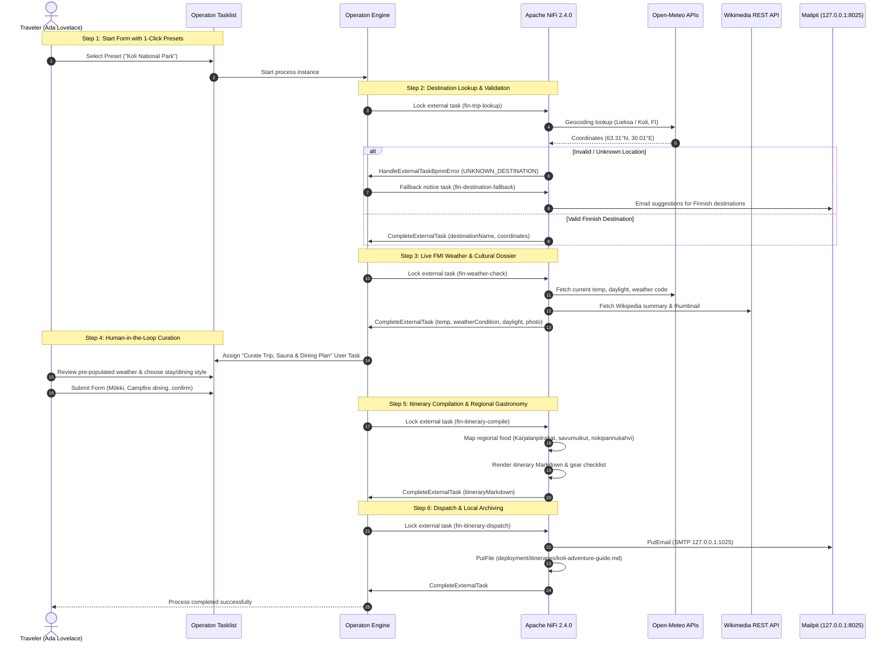

# 🌲 Finnish Travel & Outdoor Adventure Planner

The **Finnish Travel & Outdoor Adventure Planner** is a demonstration of human-in-the-loop workflow orchestration pairing **Operaton BPMN** with **Apache NiFi 2.4.0**, deterministic public open APIs, and zero heavy AI / zero LLMs.

Unlike complex synthetic enterprise scenarios, this flow solves an everyday problem: helping a traveler plan an outdoor excursion to iconic Finnish destinations—such as **Koli National Park**, **Tampere (the Sauna Capital)**, **Rovaniemi & Lapland**, or **Nuuksio National Park**—combining live meteorological data, cultural dossiers, human preferences in Operaton Tasklist, regional lunch/dinner spotlights, and local email delivery via Mailpit.

---

## 🏛️ Architecture & End-to-End Flow



---

## 🧩 Operaton Element Templates

To eliminate error-prone manual JSON typing in workflow design, this service provides [Element Templates](https://docs.camunda.io/docs/components/modeler/bpmn/element-templates/) under [`.operaton/element-templates/`](https://github.com/datakurre/operaton-nifi-service/tree/main/.operaton/element-templates).

When authoring models in the desktop modeler:
1. Drag a Service Task onto the canvas.
2. Select **Template** in the properties panel (e.g. *Operaton External Task: Fetch Destination* or *Compile Itinerary*).
3. The Modeler automatically configures `camunda:type="external"`, assigns the topic name (`fin-trip-lookup`, `fin-weather-check`, `fin-itinerary-compile`, `fin-itinerary-dispatch`), and populates input/output variable mappings.

```json
{
  "$schema": "https://unpkg.com/@camunda/element-templates-json-schema/resources/schema.json",
  "name": "Operaton NiFi: Finnish Travel External Task",
  "id": "org.operaton.nifi.travel.task",
  "appliesTo": ["bpmn:ServiceTask"],
  "properties": [
    {
      "label": "Topic Name",
      "type": "String",
      "binding": { "type": "property", "name": "camunda:topic" },
      "constraints": { "notEmpty": true }
    },
    {
      "label": "Variables Format",
      "type": "Dropdown",
      "value": "Simple JSON",
      "choices": [
        { "name": "Simple JSON", "value": "Simple JSON" },
        { "name": "Typed JSON", "value": "Operaton Typed JSON" },
        { "name": "None", "value": "None" }
      ]
    }
  ]
}
```

---

## 🗂️ NiFi 4-Column Pipeline Design

The NiFi pipeline is structured into four distinct, self-contained columns inside the `Finnish Travel Planner` process group:

```
[Column 1: fin-trip-lookup]      [Column 2: fin-weather-check]   [Column 3: fin-itinerary-compile]  [Column 4: fin-itinerary-dispatch]
Fetch Destination Task            Fetch Weather Task              Fetch Itinerary Compile Task       Fetch Dispatch Task
      │                                 │                                │                                │
Extract Trip Inputs               Extract Coordinates             Extract User Choices               Extract Dispatch Content
      │                                 │                                │                                │
Resolve City Name                 Fetch FMI Weather (InvokeHTTP)  Map Regional Food & Gear           Set Content (ReplaceText)
      │                                 │                                │                                │
Geocode Open-Meteo (InvokeHTTP)   Parse Weather Stats             Render Markdown (UpdateAttr)       Set Filename & Email Attr
      │                                 │                                │                                │
Parse Geocode Coordinates         Fetch Wikipedia (InvokeHTTP)    Prepare JSON (AttributesToJSON)    Deliver to Mailpit (PutEmail)
      │                                 │                                │                                │
Validate Location (RouteOnAttr)   Parse Cultural Extract          Complete Task                      Archive Markdown (PutFile)
 ├── [valid]   → AttributesToJSON       │                                                                 │
 │                     │          Format Dossier (UpdateAttr)                                        Complete Task
 │               Complete Task          │
 └── [unmatched] → BPMN Error     Prepare JSON (AttributesToJSON)
                       │                │
            HandleExternalTaskBpmnError Complete Task
```

### 1. Destination Geocoding & Validation (`fin-trip-lookup`)
- **`FetchAndLockExternalTasks`**: Locks task on topic `fin-trip-lookup`.
- **`EvaluateJsonPath`**: Extracts `presetDestination`, `customCity`, `travelerName`, `travelerEmail`.
- **`UpdateAttribute`**: Resolves presets (e.g. Koli $\rightarrow$ Lieksa municipal coordinates; Tampere $\rightarrow$ Tampere; Nuuksio $\rightarrow$ Espoo).
- **`InvokeHTTP`**: Queries Open-Meteo Geocoding API (`https://geocoding-api.open-meteo.com/v1/search?name=${search.city}&count=1`).
- **`RouteOnAttribute`**: Ensures the latitude is populated and country is Finland. If not, routes to `HandleExternalTaskBpmnError` with error code `UNKNOWN_DESTINATION`.
- **`AttributesToJSON` & `CompleteExternalTask`**: Marshals coordinates, country, and destination name into process variables.

### 2. Live Weather & Wikipedia Cultural Bio (`fin-weather-check`)
- **`FetchAndLockExternalTasks`**: Locks task on topic `fin-weather-check`.
- **`InvokeHTTP` (Open-Meteo FMI Weather)**: Fetches live temperature, weather code, wind speed, and sunrise/sunset times for the destination's coordinates.
- **`InvokeHTTP` (Wikimedia REST API)**: Fetches thumbnail photo URL and summary description with an explicit `Request User-Agent` header.
- **Fallback routing**: If Wikipedia summary fails or is missing, `InvokeHTTP` connects `Failure` and `No Retry` directly to `Format Destination Dossier` to guarantee pipeline resilience.
- **`AttributesToJSON` & `CompleteExternalTask`**: Pushes `currentTemp`, `weatherCondition`, `daylightHours`, `destinationDescription`, and `destinationPhoto` back to the Operaton instance.

### 3. Human-in-the-Loop Curation in Operaton Tasklist
The process reaches `UserTask_CurateTrip`. In Operaton Tasklist, the traveler inspects pre-populated live data and selects their personalized options:
- **Season Vibe**: *Autumn Ruska & Trail Hiking*, *Winter Snow & Northern Lights*, *Summer Lake Life*, or *Spring Awakening*.
- **Accommodation**: *Lakeside Mökki with Wood-Fired Sauna*, *Wilderness Camping (Laavu shelter)*, or *Spa Hotel & Resort*.
- **Dining Style**: *Wilderness Campfire Cooking*, *Traditional Regional Classics*, *Market Square & Bakery Cafes*, or *Panoramic Lakeside Dining*.
- **Dietary & Special Notes**: Custom preferences (e.g. *"Fish lover, campfire coffee on Lake Pielinen shore"*).
- **Approval Checkbox**: Submit and confirm adventure plan generation.

### 4. Itinerary Compilation & Gastronomy (`fin-itinerary-compile`)
- **`EvaluateJsonPath`**: Reads human curation choices from Tasklist.
- **`UpdateAttribute`**: Applies regional culinary mapping based on destination:
  - **Koli (North Karelia)**: Warm *Karjalanpiirakat* (Karelian rice pies with egg butter), pan-fried *savumuikut* (smoked vendace) with crushed dill potatoes, campfire kettle coffee (*nokipannukahvi*) with *leipäjuusto* (squeaky cheese) and cloudberries.
  - **Tampere (Sauna Capital)**: Authentic hot *Mustamakkara* with tart lingonberry jam & fresh cold milk at Tammelantori Market, world-famous hot cardamom donuts (*munkki*) at Pyynikki Observation Tower Cafe, wood-fired lakeside dinner at Saunaravintola Kuuma.
  - **Rovaniemi (Lapland)**: Hearty *Lohikeitto* (creamy salmon soup with fresh dill), traditional *Poronkäristys* (sautéed reindeer with mashed potatoes & sour pickles), spiced hot berry *glögi*.
- **`ReplaceText` / `AttributesToJSON`**: Formats the complete markdown briefing with a daily schedule, sauna löyly rounds, and an outdoor gear checklist.

### 5. Dispatch to Mailpit & File Archive (`fin-itinerary-dispatch`)
- **`PutEmail`**: Delivers the itinerary directly to Mailpit via local SMTP (`127.0.0.1:1025`).
- **`PutFile`**: Stores a markdown archive in `deployment/itineraries/<destination>-adventure-guide.md`.
- **`CompleteExternalTask`**: Finalizes the external task with `Variables Format: NONE`, ending the BPMN process.

---

## 🍲 Finnish Regional Gastronomy Matrix

| Destination | Lunch Spotlight | Afternoon Kahvit & Fika | Evening Dinner & Sauna |
| :--- | :--- | :--- | :--- |
| **Koli National Park** | Warm *Karjalanpiirakat* (egg butter) & campfire grilled sausages | *Nokipannukahvi* (campfire kettle coffee) & warm *leipäjuusto* with cloudberries | Crispy pan-fried *savumuikut* (smoked vendace) with dill potatoes & chanterelle sauce |
| **Tampere (Sauna Capital)** | Authentic hot *Mustamakkara* with tart lingonberry jam & cold milk at Tammelantori | Famous hot cardamom donuts (*munkki*) at historic Pyynikki Tower Cafe | Wood-fired local dining & craft cider at Saunaravintola Kuuma overlooking the harbor |
| **Rovaniemi (Lapland)** | Hearty creamy *Lohikeitto* (salmon soup) with dense sourdough rye bread | Spiced hot berry *glögi* with fresh gingerbread & arctic cloudberries | Traditional *Poronkäristys* (sautéed reindeer) over buttery mashed potatoes & pickles |
| **Nuuksio National Park** | *Loimulohi* (flame-cooked plank salmon) with pickled cucumbers by the lake | Giant fresh cinnamon-cardamom bun (*korvapuusti*) & dark roast coffee at Haltia | Wild mushroom & foraged seasonal herb dinner at a cozy lakeside lodge |

---

## 🚀 Running the Planner Locally

### 1. Ensure Services are Running
```bash
# Check Operaton BPM (http://127.0.0.1:8080)
curl -u admin:admin http://127.0.0.1:8080/engine-rest/version

# Check Apache NiFi (http://127.0.0.1:8081/nifi/)
curl http://127.0.0.1:8081/nifi-api/flow/cluster/summary

# Check Mailpit Web UI (http://127.0.0.1:8025)
curl http://127.0.0.1:8025/api/v1/messages
```

### 2. Configure Pipeline & Execute Live Test
Run the automated orchestration script:
```bash
# Run with Koli National Park preset
python3 docs/scripts/setup_travel_planner.py --test --preset koli

# Run with Tampere (Sauna Capital) preset
python3 docs/scripts/setup_travel_planner.py --test --preset tampere

# Test the BPMN boundary error for an invalid/unknown custom destination
python3 docs/scripts/setup_travel_planner.py --test --custom NonExistentCity99
```

### 3. Inspect Results
- **Operaton Tasklist**: Open `http://127.0.0.1:8080/operaton/app/tasklist/default/` (credentials `admin` / `admin`) to view active tasks and pre-populated form fields.
- **Mailpit Web UI**: Open `http://127.0.0.1:8025` to inspect rendered HTML/Markdown emails sent to `ada.lovelace@example.test`.
- **Archived Guides**: Check generated markdown guides in `deployment/itineraries/` (e.g. `koli-adventure-guide.md`).
