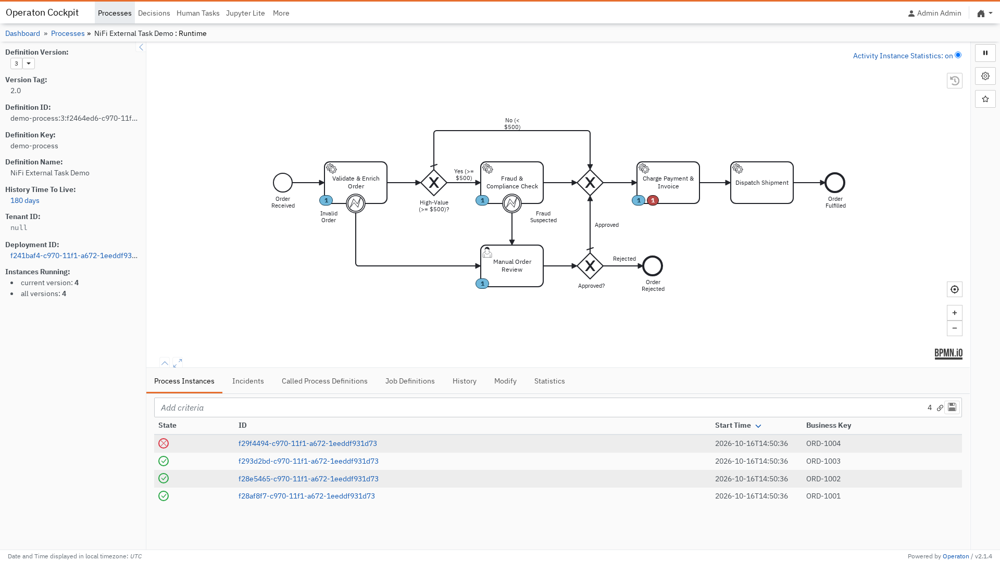
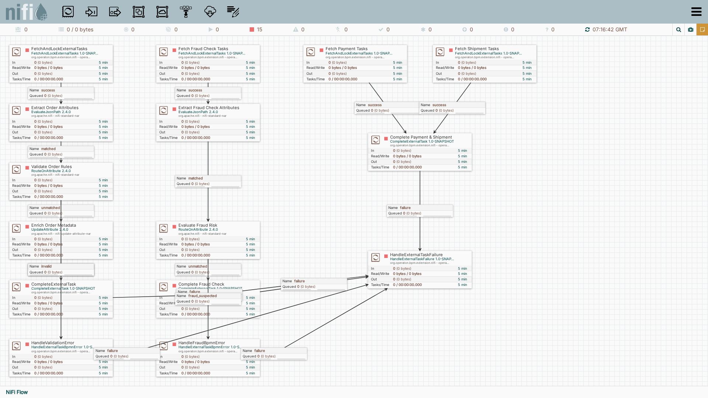
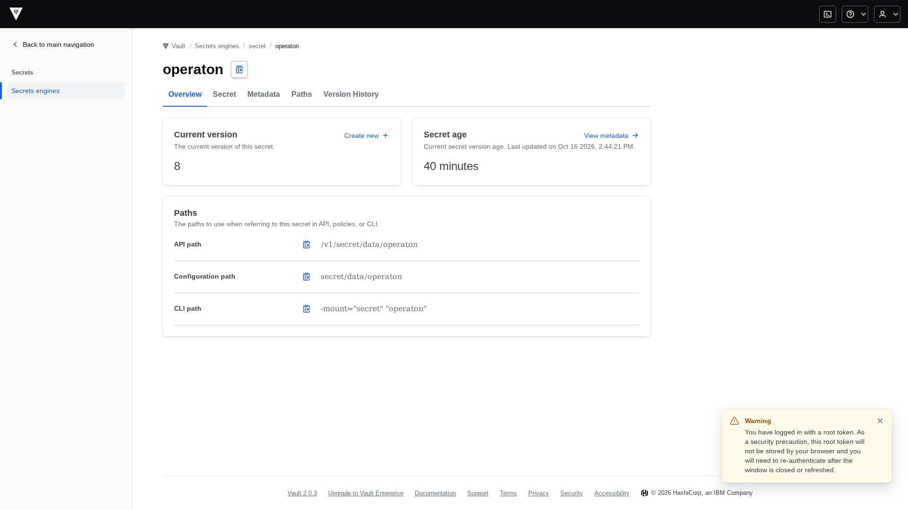
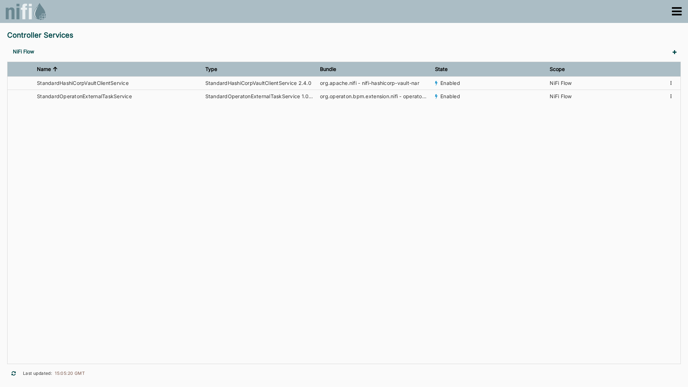
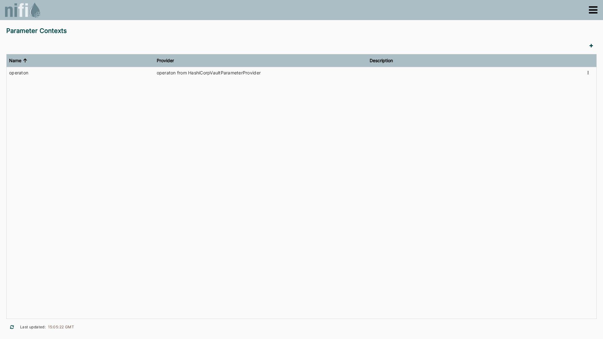
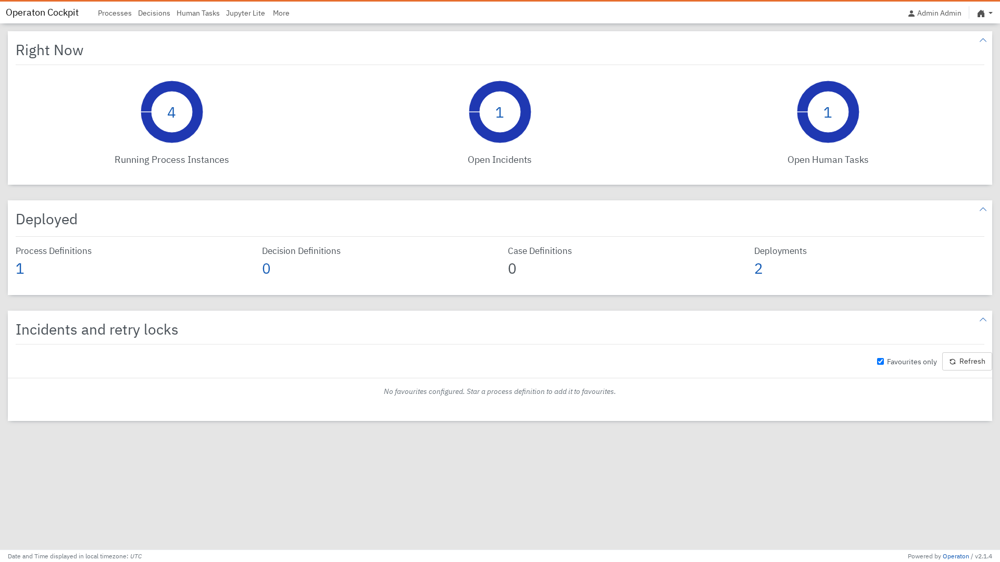
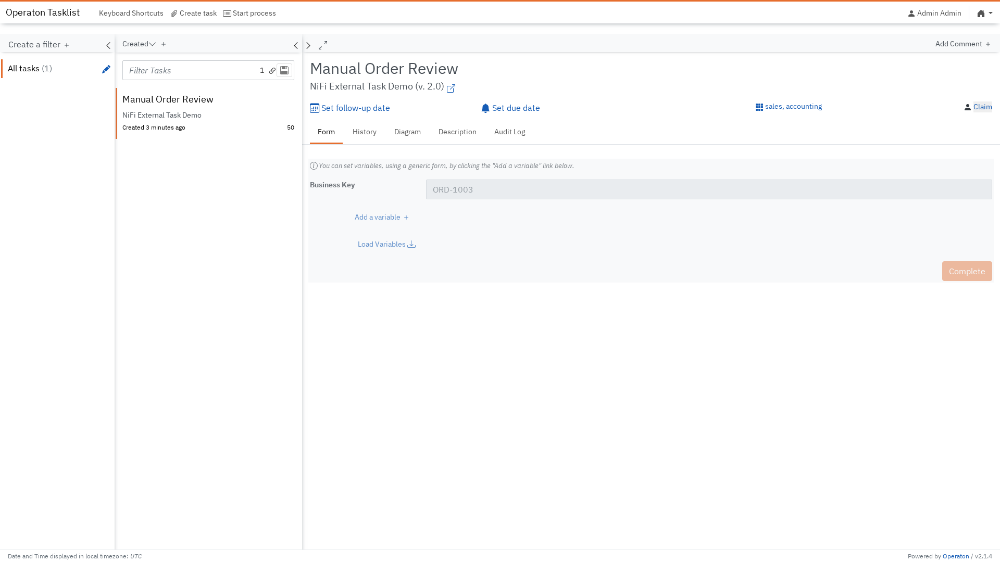

# Order Fulfillment: End-to-End BPMN & NiFi Orchestration

This guide walks through the ambitious **Order Fulfillment** sample application included in this repository. It showcases how [Operaton BPM](https://operaton.org) and [Apache NiFi 2.x](https://nifi.apache.org) combine to form a resilient, enterprise-grade orchestration pipeline secured by [HashiCorp Vault](https://www.vaultproject.io/).

---

## 1. Architectural Overview

The integration bridges long-running business process orchestration with high-throughput stream and event processing:

- **Operaton BPM 2.x**: Acts as the central state machine and orchestrator. It maintains process instances, execution tokens, transactional state, history, boundary event escalation, and human-in-the-loop task assignments.
- **Apache NiFi 2.x**: Acts as the external task worker engine. It leverages non-blocking long-polling (`/external-task/fetchAndLock`), rich data transformation (JSONPath, schema validation, enrichment), conditional routing, lock lease extensions, and error handling.
- **HashiCorp Vault**: Stores sensitive engine credentials (`url`, `worker_id`, `username`, `password`) in a KV-v2 secrets engine, automatically mapped into NiFi Parameter Contexts via `HashiCorpVaultParameterProvider`.

```mermaid
flowchart LR
    subgraph Operaton["Operaton BPM Engine"]
        Process["BPMN 2.0 Process<br/>(demo-process)"]
        Incidents["Cockpit Incidents"]
        Tasklist["Human Tasklist"]
    end

    subgraph Vault["HashiCorp Vault"]
        KV["secret/operaton<br/>(KV-v2 Secrets)"]
    end

    subgraph NiFi["Apache NiFi 2.x"]
        CS["StandardOperatonExternalTaskService<br/>(Controller Service)"]
        PC["Parameter Context<br/>#{url}, #{worker_id}, #{password}"]
        Pipeline["3-Stage Flow Canvas<br/>(Validation → Fraud Check → Payment/Fulfillment)"]
    end

    KV -->|Parameter Provider| PC
    PC --> CS
    CS <-->|REST API /external-task| Process
    Pipeline -->|BPMN Error (FRAUD_DETECTED)| Tasklist
    Pipeline -->|Technical Failure (retries=0)| Incidents
```

---

## 2. BPMN 2.0 Process Design

The BPMN model (`deployment/demo-process.bpmn`) represents a realistic order processing workflow:



### Key Process Elements

1. **Start Event (`Order Received`)**: Triggered when a new order is received with payload variables (`orderId`, `amount`, `currency`, `customer`, `itemCount`).
2. **Service Task (`Validate & Enrich Order`)**: Topic `demo`. NiFi fetches and validates the order structure and values.
   - **Error Boundary Event (`Invalid Order`)**: Catches `VALIDATION_ERROR` (code: `VALIDATION_ERROR`) and routes to `Manual Order Review` for human inspection.
3. **Exclusive Gateway (`High-Value (>= $500)?`)**:
   - Orders under $500 proceed directly to payment.
   - Orders of $500 or more require deep compliance and fraud inspection.
4. **Service Task (`Fraud & Compliance Check`)**: Topic `order-fraud-check`. NiFi performs deep risk scoring and inspection.
   - **Error Boundary Event (`Fraud Suspected`)**: Catches `FRAUD_DETECTED` (code: `FRAUD_DETECTED`) and routes to human intervention.
5. **User Task (`Manual Order Review`)**: Assigned to candidate groups `accounting, sales` (and candidate user `admin`). Human operators inspect flagged transactions in Operaton Tasklist.
6. **Exclusive Gateway (`Approved?`)**: Routes approved orders to payment, or rejected orders to `Order Rejected`.
7. **Service Tasks (`Charge Payment & Invoice` and `Dispatch Shipment`)**: Topics `order-payment` and `order-shipment`. NiFi coordinates billing and dispatch.
8. **End Event (`Order Fulfilled`)**: Successfully closes the order.

---

## 3. Apache NiFi 2.x Pipeline Flow

The NiFi canvas is structured into three clean, self-contained processing columns exercising every Operaton processor:



### Column 1: Order Validation & Schema Enrichment

```
FetchAndLockExternalTasks (topic: demo)
         │ (success)
         ▼
Extract Order Attributes (EvaluateJsonPath)
         │ (matched)
         ▼
Validate Order Rules (RouteOnAttribute)
    ├── [valid]   → Enrich Order Metadata (UpdateAttribute) → CompleteExternalTask
    └── [invalid] → HandleValidationError (HandleExternalTaskBpmnError: VALIDATION_ERROR)
```

- **`FetchAndLockExternalTasks`**: Polls topic `demo` with Simple JSON serialization. Each order instance becomes a NiFi FlowFile with order variables as JSON body and Operaton metadata as FlowFile attributes (`${operaton.externalTask.id}`, `${operaton.externalTask.businessKey}`, etc.).
- **`EvaluateJsonPath`**: Extracts `$.orderId`, `$.amount`, `$.currency`, `$.customer` into FlowFile attributes.
- **`RouteOnAttribute`**: Applies business rule expression:
  ```
  ${amount:gt(0):and(${customer:isEmpty():not()})}
  ```
- **`UpdateAttribute`**: Adds enrichment attributes (`validation.status = VALIDATED`, `validation.worker = nifi-worker`).
- **`CompleteExternalTask`**: Submits the enriched payload back to Operaton, advancing the process instance.
- **`HandleValidationError`**: If invalid, throws BPMN error `VALIDATION_ERROR` caught by the task's boundary event.

### Column 2: Fraud & Compliance Deep Inspection

```
Fetch Fraud Check Tasks (topic: order-fraud-check)
         │ (success)
         ▼
Extract Fraud Check Attributes (EvaluateJsonPath)
         │ (matched)
         ▼
ExtendExternalTaskLock (duration: 10 min)
         │ (success)
         ▼
Evaluate Fraud Risk (RouteOnAttribute)
    ├── [low_risk]  → Complete Fraud Check (CompleteExternalTask)
    └── [high_risk] → HandleFraudBpmnError (HandleExternalTaskBpmnError: FRAUD_DETECTED)
```

- **`Extract Fraud Check Attributes`**: Extracts `$.orderId` and `$.amount` from the task payload into attributes for downstream routing.
- **`ExtendExternalTaskLock`**: For intensive checks (such as external risk APIs or ML inference), explicitly extends the lock duration to 10 minutes so the lock does not expire while processing. *(Note: When **Automatic Lock Extension** is enabled on the Controller Service, active task leases are renewed automatically in the background, making this processor optional.)*
- **`RouteOnAttribute`**: Evaluates whether the transaction exceeds risk limits (`${order.amount:toNumber():gt(10000)}`).
- **`HandleFraudBpmnError`**: High-risk orders are escalated to the BPMN error boundary event with code `FRAUD_DETECTED`, setting variables `fraudReason` and `flaggedBy`. Operaton immediately routes the token to the **Manual Order Review** user task.

### Column 3: Payment, Shipment & Incident Handling

```
Fetch Payment Tasks (topic: order-payment) ──┐
                                             ├─► Complete Payment & Shipment
Fetch Shipment Tasks (topic: order-shipment) ┘         │ (failure)
                                                       ▼
                                             HandleExternalTaskFailure
```

- Parallel fetch processors lock payment and shipment tasks.
- **`CompletePaymentAndShipment`**: Completes fulfillment.
- **`HandleExternalTaskFailure`**: All processor `failure` relationships (network errors, 500s, service timeouts) route here. It decrements remaining retries and, when `retries = 0`, automatically raises an **Incident** in Operaton Cockpit.

---

## 4. HashiCorp Vault & Security Configuration

Credentials are never hardcoded. They are dynamically sourced from HashiCorp Vault KV-v2:



1. **Vault KV-v2 Secret (`secret/operaton`)**:
   Contains `url`, `worker_id`, `username`, and `password`.
2. **`StandardHashiCorpVaultClientService`**:
   Configured with `direct-properties` connecting to Vault (`http://127.0.0.1:8200`).
3. **`HashiCorpVaultParameterProvider`**:
   Synchronizes Vault secrets into the `operaton` Parameter Context, protecting `password` as a sensitive parameter.





4. **`StandardOperatonExternalTaskService`**:
   References the bound parameters:
   - Operaton REST URL: `#{url}`
   - Worker ID: `#{worker_id}`
   - Username: `#{username}`
   - Password: `#{password}`
   - Automatic Lock Extension: `false` (opt-in background renewal of active task leases; see [README](index.md#automatic-lock-extension))
   - Max Lock Lifetime: `1 hour` (maximum lease duration bound for dropped/abandoned tasks)

---

## 5. Live Demo Scenarios & Test Instances

The preconfiguration script (`docs/scripts/setup_demo_instance.py`) seeds 5 realistic order instances across every lifecycle stage:

| Business Key | Customer | Amount | Stage / State | What to Observe |
| :--- | :--- | :--- | :--- | :--- |
| **`ORD-1000`** | Edsger Dijkstra | €89.00 | **Completed (Fulfilled)** | Historical completed instance in Cockpit and history log. |
| **`ORD-1001`** | Ada Lovelace | €149.99 | **Active at Validation** | Token waiting at `Validate & Enrich Order` (topic `demo`). |
| **`ORD-1002`** | Grace Hopper | €2,450.00 | **Active at Fraud Check** | Token routed past gateway to `Fraud & Compliance Check`. |
| **`ORD-1003`** | Alan Turing | €18,500.00 | **Escalated to Human Task** | High risk triggered `FRAUD_DETECTED`; token active in Tasklist. |
| **`ORD-1004`** | Margaret Hamilton | €680.00 | **Incident (Retries = 0)** | Technical failure in Payment; red incident badge in Cockpit. |

### Operaton Cockpit Dashboard

The Cockpit dashboard displays real-time health metrics: 4 running instances, 1 open incident, and 1 human task:



### Human-in-the-Loop Tasklist

Orders flagged with `FRAUD_DETECTED` (such as `ORD-1003` for €18,500.00) appear in Operaton Tasklist with all process variables and reasons intact:



---

## 6. Running & Resetting the Demo

### Quick Start

Start the stack with devenv:

```sh
devenv up
```

Services are available at:
- **Operaton Cockpit / Tasklist**: [http://127.0.0.1:8080/operaton/](http://127.0.0.1:8080/operaton/) (`admin` / `admin`)
- **Apache NiFi Canvas**: [http://127.0.0.1:8081/nifi/](http://127.0.0.1:8081/nifi/)
- **HashiCorp Vault UI**: [http://127.0.0.1:8200/ui/](http://127.0.0.1:8200/ui/) (Token in `.devenv/state/env_file`)

### Resetting Demo Instances

To reset or recreate the demo instances and NiFi flow on demand:

```sh
devenv shell -- python3 docs/scripts/setup_demo_instance.py --reset
```

### Re-capturing Screenshots

To regenerate all publication-grade screenshots via headless Playwright:

```sh
devenv shell -- playwright-python docs/scripts/capture_screenshots.py
```

### Recording the Screencast Walkthrough

To record, compose, and verify the multi-actor screencast walkthrough demonstrating end-to-end order fulfillment and dynamic Picture-in-Picture transitions:

```sh
devenv shell -- screencast run docs/screencast/external_task_walkthrough.robot --take docs/screencast/take-1
devenv shell -- screencast compose docs/screencast/take-1
devenv shell -- screencast verify docs/screencast/take-1
```

The composed video with synchronized WebVTT subtitles is generated at `docs/screencast/take-1/output.webm`.
