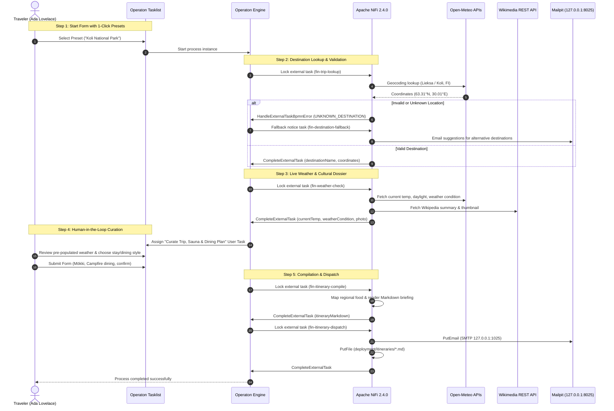
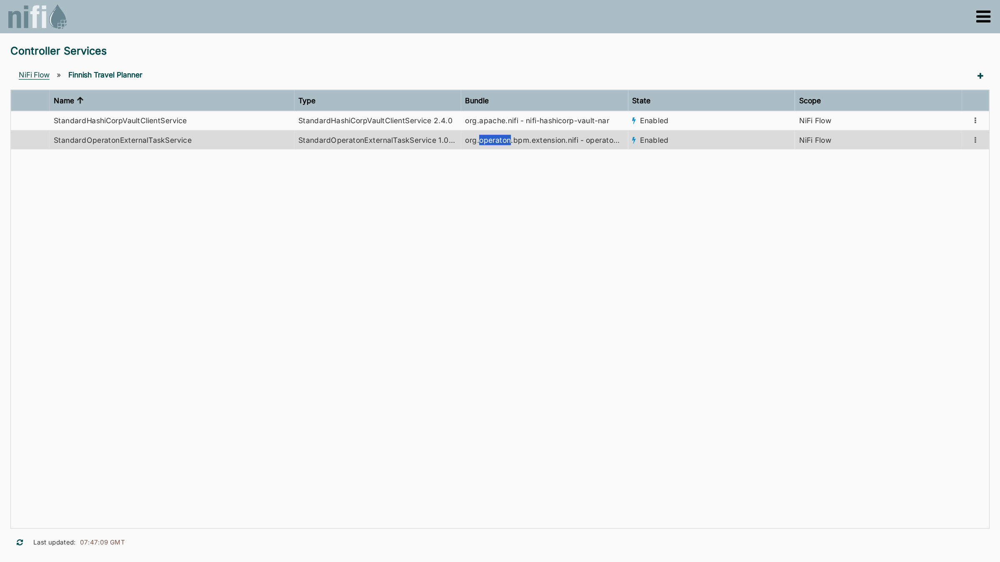
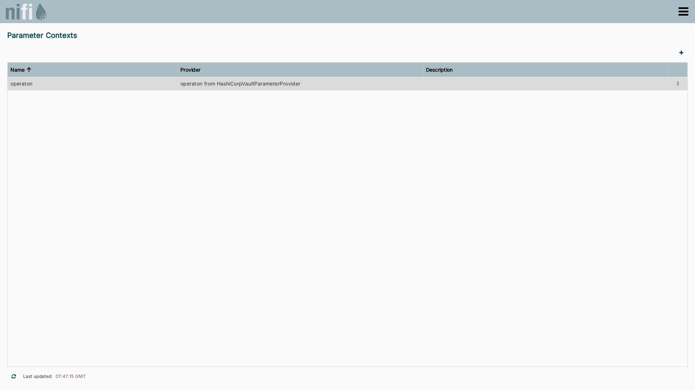
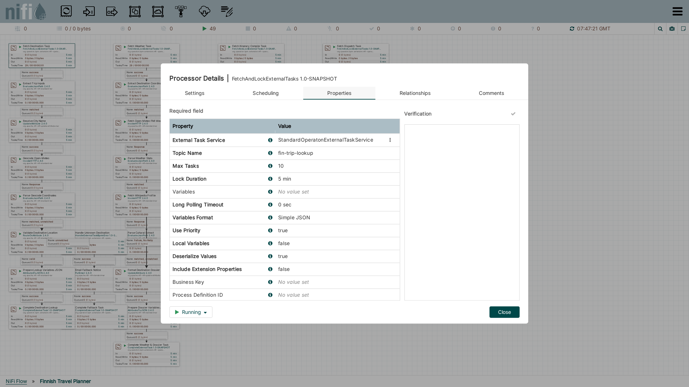
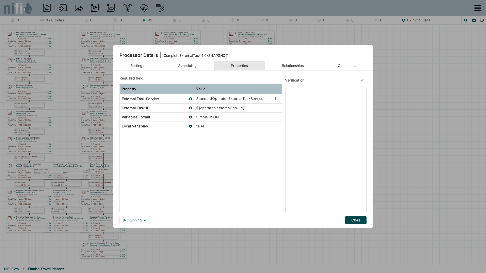
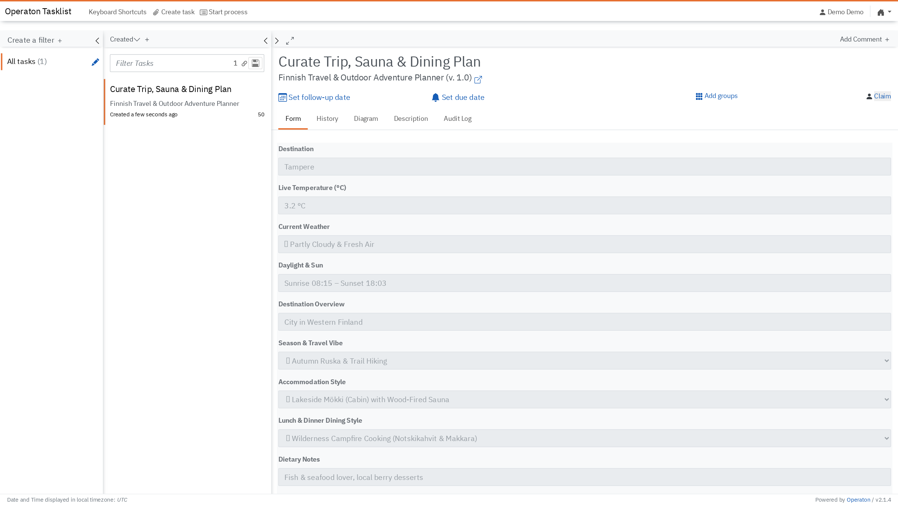
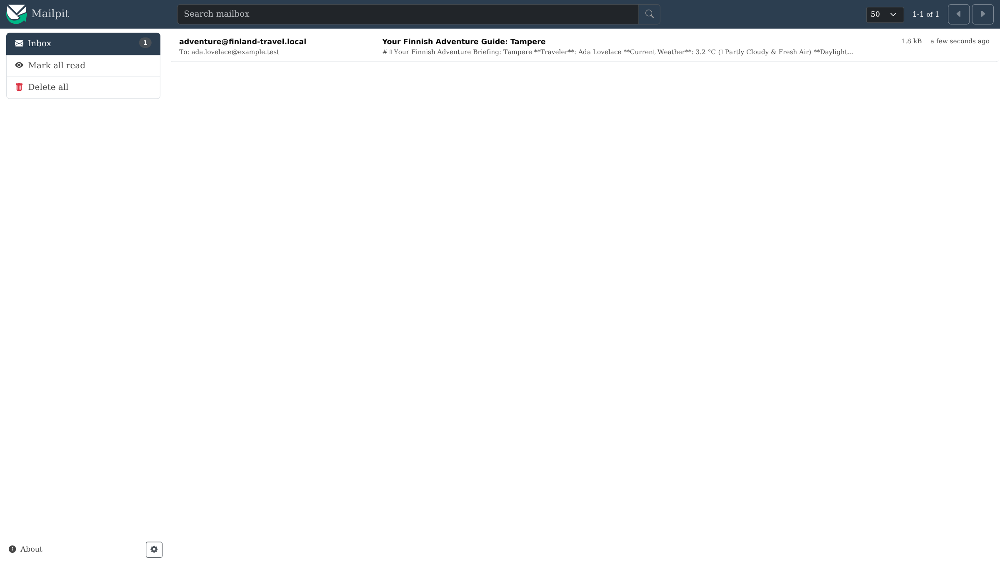

# Tutorial: Building an External Task Worker Pipeline

[](https://codespaces.new/datakurre/operaton-nifi-service)

This hands-on tutorial guides you through building, configuring, and running an end-to-end event-driven orchestration pipeline pairing **Operaton BPMN 2.0** with **Apache NiFi 2.4.0**.

Through this walkthrough, you will learn how to:
1. Model BPMN Service Tasks using **Operaton Element Templates**.
2. Configure NiFi Controller Services and bind credentials using **HashiCorp Vault Parameter Contexts**.
3. Build responsive worker pipelines that fetch tasks, query open REST APIs, transform payloads, and complete tasks.
4. Catch business rule violations with **BPMN Boundary Error Events** (`HandleExternalTaskBpmnError`).
5. Pre-populate human-in-the-loop forms in **Operaton Tasklist** and dispatch generated briefings via **Mailpit**.

---

## 1. Scenario & End-to-End Architecture

Our tutorial workflow coordinates an outdoor travel itinerary planner:
- A traveler selects an iconic destination (e.g. *Koli National Park*, *Tampere*, or a custom city).
- NiFi resolves destination coordinates via **Open-Meteo Geocoding API** (routing unknown locations to a BPMN boundary error).
- NiFi fetches live meteorological conditions and cultural highlights from **Wikimedia REST API**.
- A human operator or traveler curates lodging, sauna styles, and regional culinary preferences in **Operaton Tasklist**.
- NiFi compiles a customized Markdown briefing and delivers it via local SMTP to **Mailpit** while saving a local archive.



---

## 2. BPMN Process Design & Element Templates

The workflow model (`deployment/finnish-travel-planner.bpmn`) defines four automated service tasks and one human user task:

```
[Start] ──> [Resolve Destination] ──> [Fetch Weather & Bio] ──> [Curate Trip (User Task)]
                   │ (Boundary Error)                                     │
                   ▼                                                      ▼
           [Send Suggestions]                                    [Compile Itinerary]
                   │                                                      │
                   ▼                                                      ▼
           (Suggestions End)                                     [Dispatch & Archive]
                                                                          │
                                                                          ▼
                                                                      (Success)
```

### Eliminating Manual JSON with Element Templates
To prevent typographical errors when mapping topic names and variable formats, this project provides [Element Templates](https://docs.camunda.io/docs/components/modeler/bpmn/element-templates/) in [`.operaton/element-templates/`](https://github.com/datakurre/operaton-nifi-service/tree/main/.operaton/element-templates).

When authoring models in the Operaton/Camunda Modeler:
1. Select a Service Task on the canvas.
2. In the properties panel, choose **Template** → *Operaton External Task*.
3. The Modeler automatically assigns `camunda:type="external"`, binds the topic name (`fin-trip-lookup`), and sets the variable format to `Simple JSON`.

### Modeling BPMN Boundary Errors
The `Resolve Destination & Coordinates` task includes an attached **Error Boundary Event** configured with:
- **Error Code**: `UNKNOWN_DESTINATION`
- When NiFi encounters an unresolvable city name or location outside the target country, `HandleExternalTaskBpmnError` triggers this event, diverting execution to a fallback suggestion task.

---

## 3. Configuring the NiFi Controller Service & Vault Security

### Controller Service Configuration
All external task communication is managed by `StandardOperatonExternalTaskService`. It handles REST authentication, long polling, and **automatic background lock renewal**.

To inspect or configure the service in NiFi:
1. Open the Root Process Group Controller Services menu.
2. Select `StandardOperatonExternalTaskService` and open **View Configuration** → **Properties**:



Key configuration properties:
- **Operaton REST URL**: Points to `#{url}` resolved dynamically from Parameter Context `operaton`.
- **Worker ID**: Unique identifier `#{worker_id}` (`nifi-worker`).
- **Username / Password**: Bound to `#{username}` and `#{password}` from HashiCorp Vault.
- **Request Timeout**: `30 sec` (request timeout for REST calls).
- **Max Lock Lifetime**: `1 hour` (bounds maximum lock lease duration).

### Synchronizing Secrets with HashiCorp Vault
Sensitive credentials (`password`) and endpoint configuration (`url`, `worker_id`) are stored in Vault under secret mount `secret/operaton`. The `HashiCorpVaultParameterProvider` automatically synchronizes these secrets into NiFi's `operaton` Parameter Context:



Notice that `password` is marked as a *Sensitive parameter* (preventing plaintext leakage), while `url`, `worker_id`, and `username` are standard parameters.

---

## 4. Building the 4-Column Dataflow Pipeline in NiFi

The complete dataflow inside process group `Finnish Travel Planner` is structured into four clean columns:


---

### Column 1: Destination Geocoding & Validation (`fin-trip-lookup`)
1. **`Fetch Destination Task` (`FetchAndLockExternalTasks`)**:
   - Polls topic `fin-trip-lookup` with `Lock Duration = 5 min` and `Variables Format = Simple JSON`.
   - Each matching task generates a FlowFile containing the process variables as its JSON body, and task metadata as `operaton.externalTask.*` attributes:

   

2. **`Extract Trip Inputs` (`EvaluateJsonPath`)**:
   - Extracts `$.presetDestination`, `$.customCity`, `$.travelerName`, `$.travelerEmail` into FlowFile attributes.
3. **`Resolve City Name` (`UpdateAttribute`)**:
   - Maps presets (e.g. `koli` → Lieksa; `tampere` → Tampere; `nuuksio` → Espoo).
4. **`Geocode Open-Meteo` (`InvokeHTTP`)**:
   - Queries `https://geocoding-api.open-meteo.com/v1/search?name=${search.city}&count=1`.
5. **`Validate Destination Location` (`RouteOnAttribute`)**:
   - Checks if coordinates exist and country is Finland.
   - **Valid Route**: Converts coordinates to JSON (`AttributesToJSON`) and completes the task with `CompleteExternalTask`:

     

   - **Unmatched Route**: Routes to `Handle Unknown Destination` (`HandleExternalTaskBpmnError`), sending error code `UNKNOWN_DESTINATION` back to Operaton to trigger the boundary event.

---

### Column 2: Live Weather & Cultural Enrichment (`fin-weather-check`)
1. **`Fetch Weather Task`**: Locks tasks on topic `fin-weather-check`.
2. **`Extract Destination Coordinates`**: Reads `destinationLat` and `destinationLon`.
3. **`Fetch Open-Meteo FMI Weather` (`InvokeHTTP`)**:
   - Queries live Nordic meteorological models for temperature, wind speed, and weather code.
4. **`Fetch Wikipedia Profile` (`InvokeHTTP`)**:
   - Retrieves cultural summary extracts and scenic thumbnail image URLs from Wikimedia.
5. **`Complete Weather & Dossier Task`**:
   - Marshals `currentTemp`, `weatherCondition`, `daylightHours`, and `destinationPhoto` back to the Operaton instance.

---

### Column 3: Itinerary Compilation & Gastronomy (`fin-itinerary-compile`)
1. **`Fetch Itinerary Compile Task`**: Locks task on topic `fin-itinerary-compile`.
2. **`Extract User Choices`**: Reads the traveler's choices submitted from Operaton Tasklist.
3. **`Map Regional Food & Gear` (`UpdateAttribute`)**:
   - Dynamically selects regional culinary pairings:
     - **Koli**: Warm *Karjalanpiirakat* (rice pies with egg butter), pan-fried *savumuikut* (smoked vendace), and *nokipannukahvi* (campfire kettle coffee).
     - **Tampere**: Authentic hot *Mustamakkara* with lingonberry jam at Tammelantori Market, hot cardamom donuts (*munkki*) at Pyynikki Tower.
     - **Rovaniemi**: Creamy *Lohikeitto* (salmon soup) and traditional *Poronkäristys* (sautéed reindeer).
4. **`Render Adventure Markdown` (`ReplaceText`)**:
   - Formats a complete daily itinerary, sauna rounds, and packing checklist.
5. **`Complete Itinerary Compile`**: Submits `itineraryMarkdown` to Operaton.

---

### Column 4: Multichannel Dispatch (`fin-itinerary-dispatch`)
1. **`Fetch Dispatch Task`**: Locks task on topic `fin-itinerary-dispatch`.
2. **`Deliver Itinerary to Mailpit` (`PutEmail`)**:
   - Sends the formatted briefing via SMTP to local Mailpit (`127.0.0.1:1025`).
3. **`Archive Itinerary Markdown` (`PutFile`)**:
   - Archives the file under `deployment/itineraries/<destination>-adventure-guide.md`.
4. **`Complete Dispatch Task`**: Closes the external task, successfully terminating the workflow.

---

## 5. Human-in-the-Loop Interaction in Operaton Tasklist

When Column 2 completes, the execution token arrives at `UserTask_CurateTrip`.

1. Open **Operaton Tasklist** ([http://127.0.0.1:8080/operaton/app/tasklist/default/](http://127.0.0.1:8080/operaton/app/tasklist/default/)).
2. Select **Curate Trip, Sauna & Dining Plan**:



Notice how the form is already pre-populated with live data from NiFi:
- **Destination**: Tampere
- **Live Temperature**: `1.7 °C`
- **Current Weather**: `☀ Clear Skies & Crisp Air`
- **Daylight & Sun**: `Sunrise 08:15 – Sunset 18:03`
- **Destination Overview**: City in Western Finland
- **Season, Accommodation & Dining Choices**: Customizable dropdowns.

Submitting the form triggers Column 3 and Column 4 in NiFi.

---

## 6. Verifying Execution in Cockpit and Mailpit

### Live Process Monitoring in Operaton Cockpit
Open **Operaton Cockpit** ([http://127.0.0.1:8080/operaton/app/cockpit/default/](http://127.0.0.1:8080/operaton/app/cockpit/default/)) to watch tokens navigate the diagram in real time:


Active tokens show numeric badges (e.g. `1` waiting at the curation task), and historical traces display completed paths in green.

### Inspecting Delivered Briefings in Mailpit
Open **Mailpit Web UI** ([http://127.0.0.1:8025](http://127.0.0.1:8025)) to inspect the rendered adventure briefing email:



The delivered email includes:
- Live weather and daylight window.
- Custom daily schedule and regional food highlights (*Karjalanpiirakat*, *savumuikut*, *nokipannukahvi*).
- Gear and sauna checklist (*merino wool base layer, puukko knife, sauna towel*).

---

## 7. Interactive Screencast Walkthrough

This repository includes a multi-actor automated walkthrough screencast driven by [robotframework-screencast](https://github.com/datakurre/robotframework-screencast):

- **Script**: `docs/screencast/finnish_travel_walkthrough.robot`
- **Recording Artifact**: `docs/screencast/take-travel/output.webm`

You can run or replay the screencast take locally:
```sh
# Run the multi-actor screencast scenario
nix run github:datakurre/robotframework-screencast -- run docs/screencast/finnish_travel_walkthrough.robot --take docs/screencast/take-travel

# Compose and verify video
nix run github:datakurre/robotframework-screencast -- compose docs/screencast/take-travel
nix run github:datakurre/robotframework-screencast -- verify docs/screencast/take-travel
```
